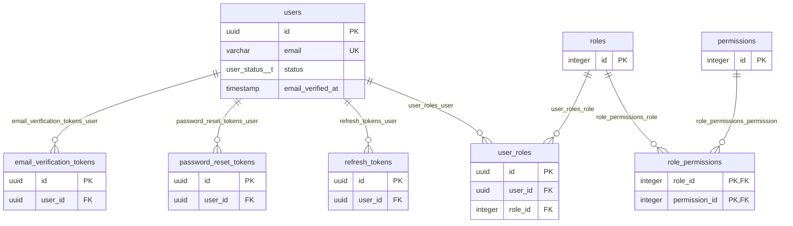
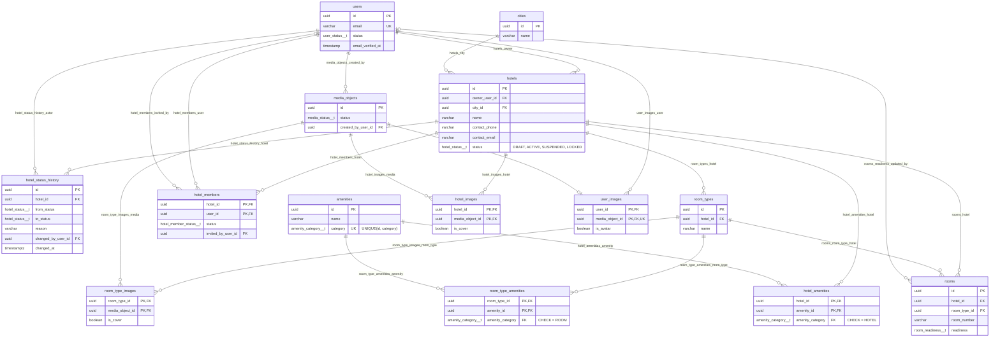
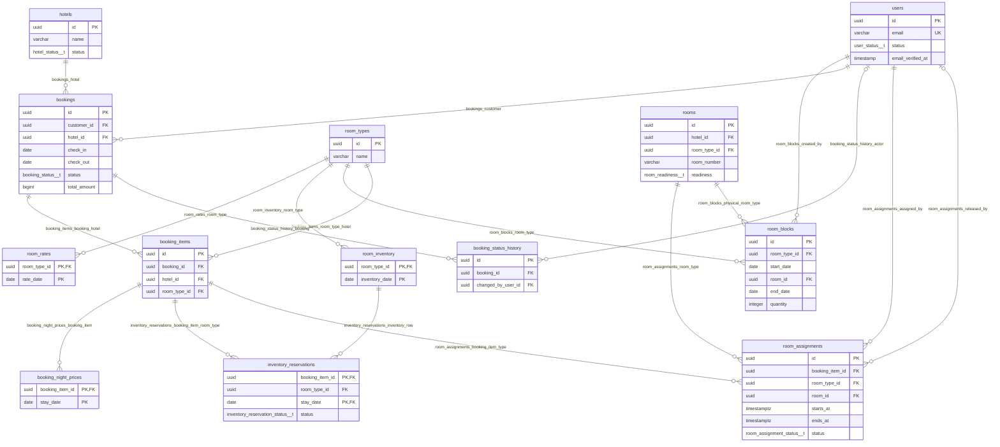
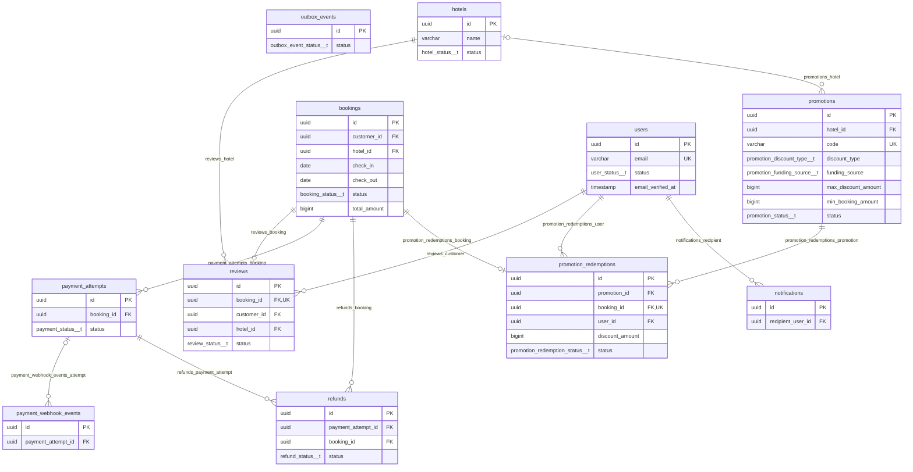
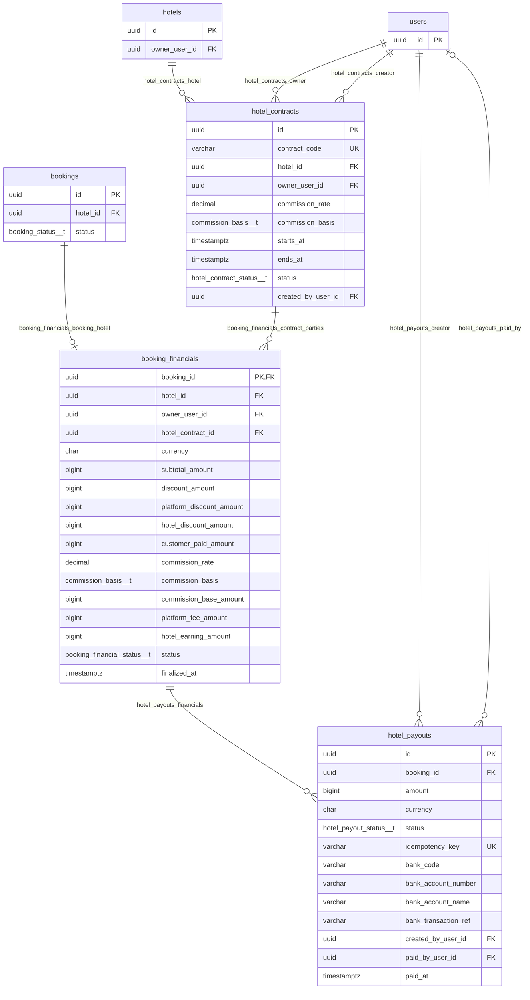

# ERD và quan hệ — Hotel Booking

[DBML hiện tại](proposals/hotel-booking-current-fixed.dbml) · [Tổng quan bản 37 bảng](README.md) · [Từ điển bản 37 bảng](data-dictionary.md)

Cập nhật 22/10/2026 theo [DBML đã sửa Ref](proposals/hotel-booking-current-fixed.dbml), từ attachment `273be3a5-0627-450d-8d02-acc0e6359e01`: **40 bảng, 348 cột, 65 FK, 70 index có tên, 25 enum**. Năm vùng sơ đồ hiển thị khóa và một số cột; bảng ngoài vùng có thể xuất hiện làm điểm nối. Mỗi FK có đúng một dòng ở mục 5; không suy thêm FK cho outbox aggregate_id hoặc refresh token family_id.

SHA-256 bản DBML đã sửa: `674f27fec0e60feabc37284eaafe85e3aa6eb9ee437415ebaf3f6aad23a8c705`.

README/từ điển DB vẫn theo bản 37 bảng, chưa bao phủ ba bảng tài chính mới trong lần sửa ba file này. DBML hiện tại không có khối checks và chưa chạy trên PostgreSQL; các bất biến tiền, chống chi trùng và hợp đồng chồng kỳ chưa được coi đã thực thi.

**Chênh lệch voucher:** promotions đã có funding_source; promotion_redemptions chưa có cột này dù nghiệp vụ yêu cầu lưu bên tài trợ khi áp mã. Sơ đồ phản ánh đúng nguồn, không vẽ cột chưa có.

Ký hiệu: đúng một `||`, không/một `|o` hoặc `o|`, không/nhiều `o{`. Nullable và UNIQUE quyết định lực lượng quan hệ; FK không buộc cha phải có bản ghi con. PK/UK nhiều cột xem từ điển, không hiểu mỗi cột là duy nhất riêng.

## 1. Identity

## 2. Hotel và Media

## 3. Inventory, Pricing và Booking

## 4. Payment, Review, Promotion và sự kiện

## 4.1. Hợp đồng, tài chính booking và chi trả Owner

- booking_financials.booking_id là PK: mỗi booking có 0 hoặc 1 bản tài chính gốc. Tổng báo cáo phải xét hoàn/điều chỉnh, không cộng lần chi như doanh thu mới.
- Hợp đồng lưu Owner ký tại thời điểm thỏa thuận. Đổi hotels.owner_user_id không tự thay bên hưởng của booking cũ.
- FINALIZED là chốt tài chính, không chứng minh đã chuyển tiền. Chỉ lần chi SUCCEEDED tính thực chi; số đủ điều kiện chi còn phụ thuộc hoàn/điều chỉnh.
- Một bản tài chính có nhiều lần thử chi để giữ lịch sử. FK/UNIQUE idempotency_key chưa ngăn yêu cầu dùng khóa khác trả cùng nghĩa vụ; cần ràng buộc và kiểm soát đồng thời khi triển khai.
- Nguồn có tài khoản nhận/tham chiếu trong hotel_payouts, chưa có bảng tài khoản ngân hàng, đối soát theo kỳ hoặc sổ điều chỉnh chuyên biệt. ERD không tự thêm những bảng đó.

## 5. Đủ 65 khóa ngoại theo nguồn

Hành vi xóa/cập nhật dưới đây được đọc từ `Ref`, không còn là chính sách tự đề xuất của bản docs cũ. Đây là cấu hình DBML, chưa xác nhận đã áp dụng vào PostgreSQL.

| FK | Bảng con(cột) → bảng cha(cột) | Cha/dòng con | Con/cha | ON DELETE | ON UPDATE |
| --- | --- | --- | --- | --- | --- |
| `fk_user_roles_user` | `user_roles(user_id) → users(id)` | 1 | 0..N | NO ACTION | NO ACTION |
| `fk_user_roles_role` | `user_roles(role_id) → roles(id)` | 1 | 0..N | NO ACTION | NO ACTION |
| `fk_role_permissions_role` | `role_permissions(role_id) → roles(id)` | 1 | 0..N | CASCADE | NO ACTION |
| `fk_role_permissions_permission` | `role_permissions(permission_id) → permissions(id)` | 1 | 0..N | CASCADE | NO ACTION |
| `fk_refresh_tokens_user` | `refresh_tokens(user_id) → users(id)` | 1 | 0..N | NO ACTION | NO ACTION |
| `fk_password_reset_tokens_user` | `password_reset_tokens(user_id) → users(id)` | 1 | 0..N | CASCADE | NO ACTION |
| `fk_hotels_owner` | `hotels(owner_user_id) → users(id)` | 1 | 0..N | NO ACTION | NO ACTION |
| `fk_hotels_city` | `hotels(city_id) → cities(id)` | 1 | 0..N | NO ACTION | NO ACTION |
| `fk_room_types_hotel` | `room_types(hotel_id) → hotels(id)` | 1 | 0..N | NO ACTION | NO ACTION |
| `fk_hotel_amenities_hotel` | `hotel_amenities(hotel_id) → hotels(id)` | 1 | 0..N | CASCADE | NO ACTION |
| `fk_hotel_amenities_amenity` | `hotel_amenities(amenity_id, amenity_category) → amenities(id, category)` | 1 | 0..N | NO ACTION | NO ACTION |
| `fk_hotel_status_history_hotel` | `hotel_status_history(hotel_id) → hotels(id)` | 1 | 0..N | NO ACTION | NO ACTION |
| `fk_hotel_status_history_actor` | `hotel_status_history(changed_by_user_id) → users(id)` | 1 | 0..N | NO ACTION | NO ACTION |
| `fk_room_type_amenities_room_type` | `room_type_amenities(room_type_id) → room_types(id)` | 1 | 0..N | CASCADE | NO ACTION |
| `fk_room_type_amenities_amenity` | `room_type_amenities(amenity_id, amenity_category) → amenities(id, category)` | 1 | 0..N | NO ACTION | NO ACTION |
| `fk_media_objects_created_by` | `media_objects(created_by_user_id) → users(id)` | 1 | 0..N | RESTRICT | NO ACTION |
| `fk_hotel_images_hotel` | `hotel_images(hotel_id) → hotels(id)` | 1 | 0..N | CASCADE | NO ACTION |
| `fk_hotel_images_media` | `hotel_images(media_object_id) → media_objects(id)` | 1 | 0..N | RESTRICT | NO ACTION |
| `fk_room_type_images_room_type` | `room_type_images(room_type_id) → room_types(id)` | 1 | 0..N | CASCADE | NO ACTION |
| `fk_room_type_images_media` | `room_type_images(media_object_id) → media_objects(id)` | 1 | 0..N | RESTRICT | NO ACTION |
| `fk_hotel_members_hotel` | `hotel_members(hotel_id) → hotels(id)` | 1 | 0..N | CASCADE | NO ACTION |
| `fk_hotel_members_user` | `hotel_members(user_id) → users(id)` | 1 | 0..N | RESTRICT | NO ACTION |
| `fk_hotel_members_invited_by` | `hotel_members(invited_by_user_id) → users(id)` | 0..1 | 0..N | SET NULL | NO ACTION |
| `fk_room_rates_room_type` | `room_rates(room_type_id) → room_types(id)` | 1 | 0..N | CASCADE | NO ACTION |
| `fk_room_inventory_room_type` | `room_inventory(room_type_id) → room_types(id)` | 1 | 0..N | RESTRICT | NO ACTION |
| `fk_room_blocks_room_type` | `room_blocks(room_type_id) → room_types(id)` | 1 | 0..N | RESTRICT | NO ACTION |
| `fk_room_blocks_created_by` | `room_blocks(created_by_user_id) → users(id)` | 1 | 0..N | RESTRICT | NO ACTION |
| `fk_bookings_customer` | `bookings(customer_id) → users(id)` | 1 | 0..N | RESTRICT | NO ACTION |
| `fk_bookings_hotel` | `bookings(hotel_id) → hotels(id)` | 1 | 0..N | RESTRICT | NO ACTION |
| `fk_booking_items_booking_hotel` | `booking_items(booking_id, hotel_id) → bookings(id, hotel_id)` | 1 | 0..N | CASCADE | NO ACTION |
| `fk_booking_items_room_type_hotel` | `booking_items(room_type_id, hotel_id) → room_types(id, hotel_id)` | 1 | 0..N | RESTRICT | NO ACTION |
| `fk_booking_night_prices_booking_item` | `booking_night_prices(booking_item_id) → booking_items(id)` | 1 | 0..N | CASCADE | NO ACTION |
| `fk_inventory_reservations_booking_item_room_type` | `inventory_reservations(booking_item_id, room_type_id) → booking_items(id, room_type_id)` | 1 | 0..N | RESTRICT | NO ACTION |
| `fk_inventory_reservations_inventory_row` | `inventory_reservations(room_type_id, stay_date) → room_inventory(room_type_id, inventory_date)` | 1 | 0..N | RESTRICT | NO ACTION |
| `fk_booking_status_history_booking` | `booking_status_history(booking_id) → bookings(id)` | 1 | 0..N | CASCADE | NO ACTION |
| `fk_complaints_booking_hotel` | `complaints(booking_id, hotel_id) → bookings(id, hotel_id)` | 1 | 0..N | RESTRICT | NO ACTION |
| `fk_complaints_customer` | `complaints(customer_id) → users(id)` | 1 | 0..N | RESTRICT | NO ACTION |
| `fk_booking_status_history_actor` | `booking_status_history(changed_by_user_id) → users(id)` | 0..1 | 0..N | SET NULL | NO ACTION |
| `fk_reviews_booking` | `reviews(booking_id) → bookings(id)` | 1 | 0..1 | RESTRICT | NO ACTION |
| `fk_reviews_customer` | `reviews(customer_id) → users(id)` | 1 | 0..N | RESTRICT | NO ACTION |
| `fk_reviews_hotel` | `reviews(hotel_id) → hotels(id)` | 1 | 0..N | RESTRICT | NO ACTION |
| `fk_payment_attempts_booking` | `payment_attempts(booking_id) → bookings(id)` | 1 | 0..N | RESTRICT | NO ACTION |
| `fk_payment_webhook_events_attempt` | `payment_webhook_events(payment_attempt_id) → payment_attempts(id)` | 0..1 | 0..N | SET NULL | NO ACTION |
| `fk_refunds_payment_attempt` | `refunds(payment_attempt_id) → payment_attempts(id)` | 1 | 0..N | RESTRICT | NO ACTION |
| `fk_refunds_booking` | `refunds(booking_id) → bookings(id)` | 1 | 0..N | RESTRICT | NO ACTION |
| `fk_promotions_hotel` | `promotions(hotel_id) → hotels(id)` | 0..1 | 0..N | SET NULL | NO ACTION |
| `fk_promotion_redemptions_promotion` | `promotion_redemptions(promotion_id) → promotions(id)` | 1 | 0..N | RESTRICT | NO ACTION |
| `fk_promotion_redemptions_booking` | `promotion_redemptions(booking_id) → bookings(id)` | 1 | 0..1 | RESTRICT | NO ACTION |
| `fk_promotion_redemptions_user` | `promotion_redemptions(user_id) → users(id)` | 1 | 0..N | RESTRICT | NO ACTION |
| `fk_notifications_recipient` | `notifications(recipient_user_id) → users(id)` | 1 | 0..N | CASCADE | NO ACTION |
| `fk_rooms_hotel` | `rooms(hotel_id) → hotels(id)` | 1 | 0..N | RESTRICT | NO ACTION |
| `fk_rooms_room_type_hotel` | `rooms(room_type_id, hotel_id) → room_types(id, hotel_id)` | 1 | 0..N | RESTRICT | NO ACTION |
| `fk_rooms_readiness_updated_by` | `rooms(readiness_updated_by) → users(id)` | 0..1 | 0..N | RESTRICT | NO ACTION |
| `fk_room_assignments_booking_item_type` | `room_assignments(booking_item_id, room_type_id) → booking_items(id, room_type_id)` | 1 | 0..N | RESTRICT | NO ACTION |
| `fk_room_assignments_room_type` | `room_assignments(room_id, room_type_id) → rooms(id, room_type_id)` | 1 | 0..N | RESTRICT | NO ACTION |
| `fk_room_assignments_assigned_by` | `room_assignments(assigned_by) → users(id)` | 1 | 0..N | RESTRICT | NO ACTION |
| `fk_room_assignments_released_by` | `room_assignments(released_by) → users(id)` | 0..1 | 0..N | RESTRICT | NO ACTION |
| `fk_email_verification_tokens_user` | `email_verification_tokens(user_id) → users(id)` | 1 | 0..N | CASCADE | NO ACTION |
| `fk_user_images_user` | `user_images(user_id) → users(id)` | 1 | 0..N | CASCADE | NO ACTION |
| `fk_user_images_media` | `user_images(media_object_id) → media_objects(id)` | 1 | 0..1 | RESTRICT | NO ACTION |
| `fk_room_blocks_physical_room_type` | `room_blocks(room_id, room_type_id) → rooms(id, room_type_id)` | 1 | 0..N | RESTRICT | NO ACTION |
| `fk_hotel_contracts_hotel` | `hotel_contracts(hotel_id) → hotels(id)` | 1 | 0..N | RESTRICT | NO ACTION |
| `ex_hotel_contracts_active_period` (EXCLUDE, không phải FK) | `hotel_contracts(hotel_id =, tstzrange(starts_at, ends_at, '[)') &&) WHERE status = 'ACTIVE'` | — | — | — | — |
| `fk_hotel_contracts_owner` | `hotel_contracts(owner_user_id) → users(id)` | 1 | 0..N | RESTRICT | NO ACTION |
| `fk_hotel_contracts_creator` | `hotel_contracts(created_by_user_id) → users(id)` | 1 | 0..N | RESTRICT | NO ACTION |
| `fk_booking_financials_booking_hotel` | `booking_financials(booking_id, hotel_id) → bookings(id, hotel_id)` | 1 | 0..1 | RESTRICT | NO ACTION |
| `fk_booking_financials_contract_parties` | `booking_financials(hotel_contract_id, hotel_id, owner_user_id) → hotel_contracts(id, hotel_id, owner_user_id)` | 1 | 0..N | RESTRICT | NO ACTION |
| `fk_hotel_payouts_financials` | `hotel_payouts(booking_id) → booking_financials(booking_id)` | 1 | 0..N | RESTRICT | NO ACTION |
| `fk_hotel_payouts_creator` | `hotel_payouts(created_by_user_id) → users(id)` | 1 | 0..N | RESTRICT | NO ACTION |
| `fk_hotel_payouts_paid_by` | `hotel_payouts(paid_by_user_id) → users(id)` | 0..1 | 0..N | RESTRICT | NO ACTION |

## 6. Các FK ghép cần giữ

| Quan hệ | Ý nghĩa |
| --- | --- |
| `hotel_amenities.(amenity_id, amenity_category) → amenities.(id, category)` | Khách sạn chỉ gắn tiện ích HOTEL; CHECK amenity_category = 'HOTEL', cha có `uq_amenities_id_category` (Flyway V20261110120000000) |
| `room_type_amenities.(amenity_id, amenity_category) → amenities.(id, category)` | Loại phòng chỉ gắn tiện ích ROOM; CHECK amenity_category = 'ROOM', cùng UNIQUE(id, category) ở cha |
| `booking_items.(booking_id, hotel_id) → bookings.(id, hotel_id)` | Hạng mục thuộc đúng hotel của đơn |
| `booking_items.(room_type_id, hotel_id) → room_types.(id, hotel_id)` | Loại phòng cùng hotel với đơn |
| `inventory_reservations.(booking_item_id, room_type_id) → booking_items.(id, room_type_id)` | Ledger cùng loại phòng với hạng mục |
| `inventory_reservations.(room_type_id, stay_date) → room_inventory.(room_type_id, inventory_date)` | Ledger trỏ đúng dòng tồn/ngày |
| `rooms.(room_type_id, hotel_id) → room_types.(id, hotel_id)` | Phòng vật lý thuộc đúng hotel của loại phòng |
| `room_assignments.(booking_item_id, room_type_id) → booking_items.(id, room_type_id)` | Phân công đúng loại phòng đã mua |
| `room_assignments.(room_id, room_type_id) → rooms.(id, room_type_id)` | Phòng được gán đúng loại; qua room type bảo đảm cùng hotel |
| `room_blocks.(room_id, room_type_id) → rooms.(id, room_type_id)` | Lịch chặn đúng phòng vật lý và loại phòng |
| `booking_financials.(booking_id, hotel_id) → bookings.(id, hotel_id)` | Bản tài chính đúng hotel của booking; PK booking_id giới hạn một bản/đơn |
| `booking_financials.(hotel_contract_id, hotel_id, owner_user_id) → hotel_contracts.(id, hotel_id, owner_user_id)` | Đúng thỏa thuận, khách sạn và Owner ký; nhóm cột cha có UNIQUE ghép |

`booking_items` không cần một room_id vì quantity có thể lớn hơn 1. Hai phòng được gán tạo hai room_assignments; một phòng có nhiều phân công qua các kỳ, nhưng các kỳ đang chiếm phòng không được chồng nhau.

## 7. Các quan hệ cần đọc cẩn thận

- `reviews.booking_id` UNIQUE: mỗi booking có tối đa một review.
- hotel_contracts có UNIQUE contract_code và UNIQUE(id, hotel_id, owner_user_id), chưa có ràng buộc khoảng hiệu lực không chồng nhau.
- hotel_payouts.idempotency_key UNIQUE nhận diện một yêu cầu; booking_id không UNIQUE để giữ lần thử thất bại. Chưa có partial UNIQUE giới hạn các lần PENDING/PROCESSING/SUCCEEDED cho cùng booking.
- promotions.funding_source là PLATFORM/HOTEL; hotel_id vẫn chỉ phạm vi sử dụng. Snapshot bên tài trợ ở redemption còn thiếu.
- `promotion_redemptions.booking_id` UNIQUE: mỗi booking có tối đa một voucher đã áp.
- `user_images.media_object_id` UNIQUE: mỗi media object thuộc tối đa một dòng ảnh tài khoản; một user vẫn có nhiều ảnh.
- `promotions.hotel_id` nullable: không hotel là mã toàn hệ thống. ON DELETE SET NULL hiện tại có rủi ro đổi ý nghĩa mã riêng thành toàn hệ thống khi xóa hotel; xem DB-06 trong README.
- CASCADE xóa liên kết trong DB không tự xóa tệp trên object storage. Chính sách nghiệp vụ vẫn cần giữ lịch sử booking, giao dịch và phân công.

## 8. Những gì FK chưa bảo đảm

FK riêng của review/redemption chưa kiểm tra user/hotel khớp booking; refund chưa kiểm tra booking khớp payment attempt. FK không kiểm tra vai trò, email đã xác minh, trạng thái READY, thời gian voucher, hạn mức, tổng tiền liên bảng, số phân công hoặc chống trùng lịch. Các điều kiện này cần ràng buộc bổ sung hoặc logic giao dịch nhất quán.

Với tài chính, FK ghép giữ đúng booking/hotel/contract/Owner nhưng chưa kiểm tra hiệu lực hợp đồng, quyền ký, tỷ lệ/căn cứ/làm tròn, tổng tiền, tài khoản nhận, điều kiện FINALIZED hoặc số được chi sau hoàn. Nguồn đã bỏ checks, chưa có sổ điều chỉnh đầy đủ hoặc khóa/ràng buộc riêng chống chi song song. Số gốc trong booking_financials không tự chứng minh doanh thu ròng hoặc số dư có thể rút. Không suy thêm FK trực tiếp giữa refunds và booking_financials khi nguồn chỉ liên kết gián tiếp qua booking.
